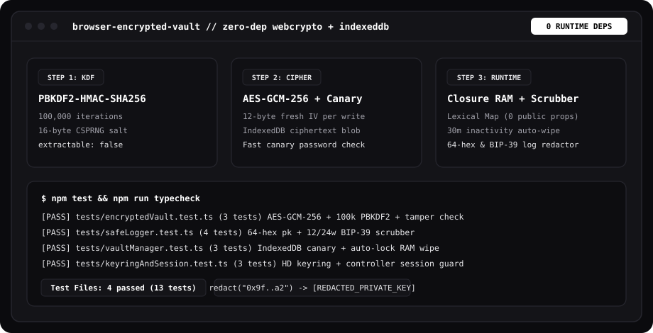

# browser-encrypted-vault


one night i almost printed my real burner private key on a live screen share. my soul left my body for five seconds. drank strong 3am adrak chai and built this encrypted browser vault so that never happens again.



## what is this

this is a tiny password locked wallet vault for browsers and Node. it has zero external packages.

* it locks your keys using WebCrypto AES 256 and 100,000 password rounds.
* it saves only locked scrambles inside IndexedDB, never plain text keys.
* unlocked keys hide inside a private RAM closure. `Object.keys` shows nothing. it is not a bug bhai, it is a surprise feature.
* if you walk away for 30 minutes to eat maggi, it auto locks and wipes RAM.
* `safeLogger` catches 64 char hex keys and 12 word seed phrases before `console.log` can leak them.

## copy and run in 60 sec

```bash
git clone https://github.com/LevCodeLab/browser-encrypted-vault.git
cd browser-encrypted-vault
npm install
npm test
npm run typecheck
```

quick code example:

```ts
import {
  vaultManager,
  memoryKeyStore,
  generateSecureMnemonic,
  deriveSecureAccount,
  safeLogger
} from "./src";

const phrase = await generateSecureMnemonic(12);
const acct = await deriveSecureAccount(phrase, 0);

await vaultManager.initializeVault("strong_chai_123", {
  version: 1,
  chainId: 8453,
  createdAt: Date.now(),
  mnemonic: phrase,
  accounts: [
    {
      id: acct.id,
      address: acct.address,
      short: acct.short,
      privateKey: memoryKeyStore.getKey(acct.address)
    }
  ]
});

// safeLogger hides your seed phrase automatically
safeLogger.info("my seed:", phrase);
```

## how to edit files

every file is small and easy to read.

* `src/encryptedVault.ts`: change password rounds (`PBKDF2_ITERATIONS`) here.
* `src/vaultManager.ts`: change the 30 minute auto lock timer (`DEFAULT_AUTO_LOCK_TIMEOUT_MS`) here.
* `src/safeLogger.ts`: add extra secret field names like `apiKey` to `SENSITIVE_KEYS` here.
* `src/secureEntropy.ts`: edit 12 or 24 word seed phrase generation and RAM key storage here.
* `src/keyringManager.ts`: edit child wallet creation from one master secret here.
* `src/storage/sessionRecovery.ts`: edit local session save and wallet match checks here.

## license

MIT. see [LICENSE](./LICENSE).
